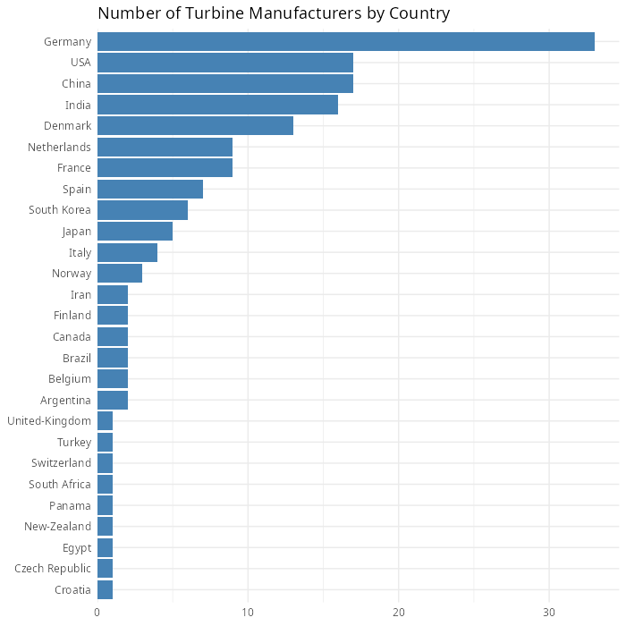
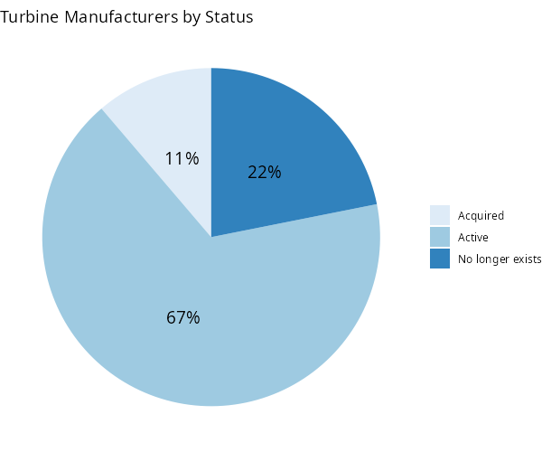
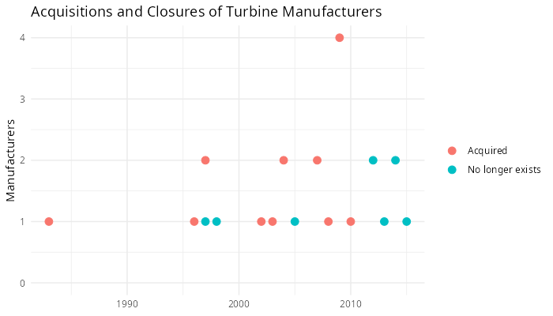
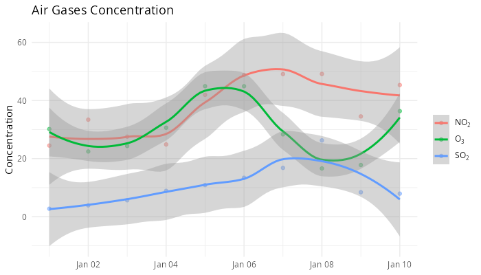
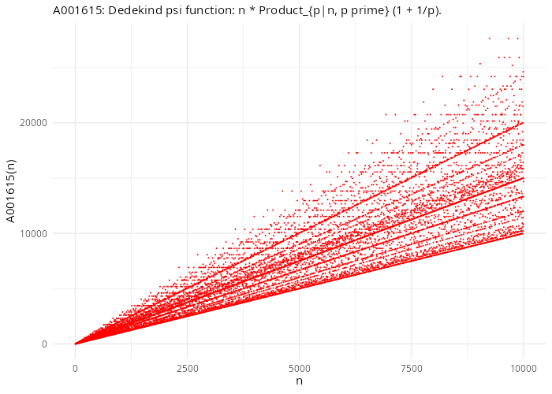
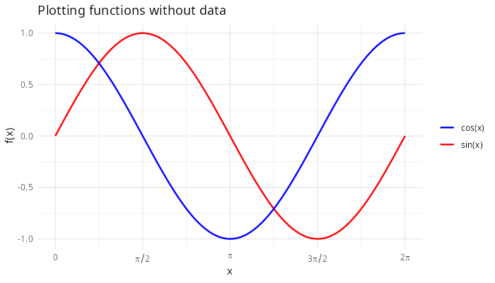
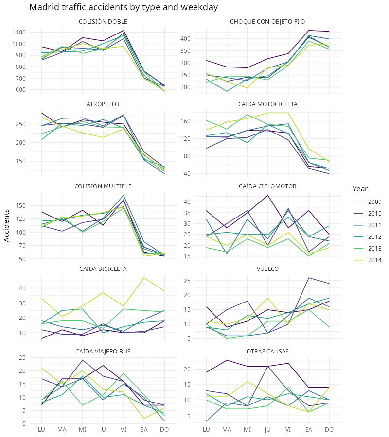

# R-Plots-Examples

Small, self-contained R plotting examples for learning R with the tidyverse
(`dplyr`, `tidyr`, `ggplot2`) and a few interactive/3D packages.

| Folder | Script | What it shows | Extra packages |
| --- | --- | --- | --- |
| [`01-wind-energy`](01-wind-energy) | `turbines_manufacturers.R` | Bar, pie and scatter plots of wind-turbine manufacturers by country, status and year | `scales`, `rvest` (only to refresh data) |
| [`02-air-gases`](02-air-gases) | `air_gases.R` | Multiple series with LOESS smoothing and plotmath legend labels (NO₂, SO₂, O₃) | — |
| [`03-oeis-plot`](03-oeis-plot) | `oeis_plot.R` | Plotting an OEIS integer sequence from its b-file, metadata via the OEIS JSON API | `jsonlite` |
| [`04-function-plot`](04-function-plot) | `function_plot.R` | Plotting functions without data (`stat_function`) with π axis labels | — |
| [`04-function-plot`](04-function-plot) | `parametric_3d_plot.R` | Parametric 3D curve with a time slider (RStudio only) | `plot3D`, `manipulate` |
| [`05-madrid-traffic`](05-madrid-traffic) | `madrid_traffic.R` | Reading a multi-sheet Excel file and faceted line plots of Madrid traffic accidents | `readxl` |
| [`06-network`](06-network) | `network.R` | Interactive network graph | `networkD3` |
| [`07-spain-map`](07-spain-map) | `spain_map.R` | Choropleth map of population density by province with `sf` and `geom_sf` | `sf`, `mapSpain` |

See [MANIFEST](MANIFEST) for a description of every file in the repository.

## Gallery

|   |   |
| --- | --- |
|  |  |
|  |  |
|  |  |



## Installation

Requires R ≥ 4.1 (the scripts use the native `|>` pipe).

**1. System libraries** — only needed for `07-spain-map` (`sf` is compiled
against GDAL, GEOS, PROJ, udunits and Abseil). On Debian/Ubuntu:

```sh
sudo apt install libgdal-dev libgeos-dev libproj-dev libudunits2-dev libabsl-dev
```

**2. R packages**:

```sh
make install
```

or, without `make`:

```sh
S2_FORCE_BUNDLED_ABSEIL=false Rscript -e 'install.packages(c(
    "dplyr", "tidyr", "ggplot2", "scales", "rvest", "jsonlite", "readxl",
    "plot3D", "manipulate", "networkD3", "sf", "mapSpain", "lintr", "styler"),
    repos = "https://cloud.r-project.org")'
```

`S2_FORCE_BUNDLED_ABSEIL=false` makes the `s2` package (a dependency of `sf`)
use the system Abseil from `libabsl-dev`. Without it, on Linux `s2` always tries
to build its own copy of Abseil, which fails unless `cmake` is installed.

## Usage

The ggplot2 examples save their plot as a PNG next to the script. With `make`:

```sh
make                    # regenerate every PNG (only the out-of-date ones)
make 02-air-gases       # regenerate one example
make lint               # check R style with lintr (rules in .lintr)
make style              # reformat R scripts with styler
make clean              # delete the generated PNGs
```

Or run a script directly from its own folder:

```sh
cd 01-wind-energy
Rscript turbines_manufacturers.R
```

`03-oeis-plot` and `07-spain-map` need an internet connection. `parametric_3d_plot.R`
(RStudio only) and `network.R` (interactive widget) are meant to be run
interactively.

## License

GPL-3.0 — see [LICENSE.txt](LICENSE.txt).
